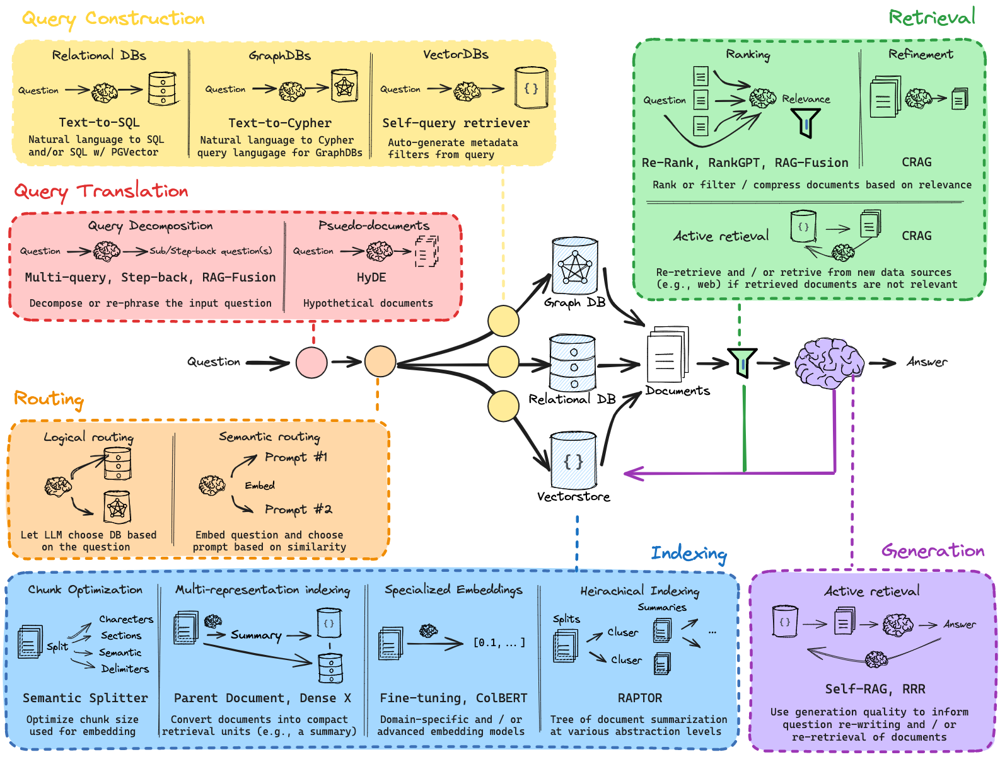

# LangChain、LangGraph、RAG关系
`RAG`：提供检索外部整理好的知识的能力
`LangChain`：提供实现每个步骤的组件
`LangGraph`：控制这些步骤如何运行
```text
LangGraph：控制Agent整体调用流程
   ↓
LangChain：提供模型、工具和检索组件
   ↓
RAG：作为 Agent 可选择调用的一项能力
```
**一个高级RAG项目可以是**：
```text
LangGraph工作流
├── LangChain查询改写组件
├── LangChain向量检索器
├── LangChain SQL工具
├── LangChain Reranker
├── LangChain LLM
└── LangGraph判断、循环和记忆
```
# LangChain

# LangGraph

# RAG

## RAG（Retrieval-Augmented Generation，检索增强生成）系统的完整技术地图


不同颜色代表不同阶段：

| 颜色 | 阶段                         |
| ---- | ---------------------------- |
| 黄色 | Query Construction，查询构造 |
| 红色 | Query Translation，查询转换  |
| 橙色 | Routing，路由                |
| 蓝色 | Indexing，索引               |
| 绿色 | Retrieval，检索              |
| 紫色 | Generation，生成             |


**查询构造 → 查询转换 → 路由 → 索引 → 检索优化 → 答案生成**

**具体为**：
用户问题
  ↓
理解、改写或拆解问题
  ↓
判断应该查询哪个数据源
  ↓
从关系数据库、图数据库、向量数据库中检索
  ↓
对检索结果排序、过滤、纠错
  ↓
将有效文档交给大模型
  ↓
生成答案

## 一、蓝色区域：Indexing 索引优化

索引先将资料整理为便于检索的结构，为后续处理提供基础。

本区方法可按数据特点选择一种或组合使用，不必依次执行。

索引阶段发生在用户提问之前。

它解决的问题是：文档应该如何切分、表示和存储，才能在检索时更容易找到正确内容？


### 1. Chunk Optimization 分块优化

向量数据库一般不会直接存储整本书或整个 PDF，而是把文档拆成 Chunk。

图中提到了：

- 按字符切分
- 按章节切分
- 按分隔符切分
- 语义切分
- 固定长度切分

例如每 500 个字符切一块，并保留 100 字重叠。

优点是简单，缺点是可能从一句话中间切断。

#### 章节切分

根据标题、段落、Markdown 层级进行切分。

例如：

```text
第一章
  1.1
  1.2
第二章
```

更适合结构化文档。

#### Semantic Splitter

Semantic Splitter 是一种按语义边界切分文本的方法。

根据语义变化切分。

例如以下两个段落语义明显不同：

- 第一段：介绍FastAPI路由。
- 第二段：介绍Qdrant向量搜索。

Semantic Splitter 会尽量在语义边界处切开，而不是机械地按字符数量切分。

### 2. Multi-representation Indexing 多表示索引

图中提到了：

- **Parent Document**：一种父子文档检索方法。
- **Dense X**：这里指密集向量表示的思路。

基本思想是：

检索时使用适合搜索的小块，返回时使用信息更完整的大块。

例如：

- 父文档：完整章节，3000字
- 子块：每块300字
- 摘要：该章节的100字摘要

向量数据库里可以索引子块或摘要。

当某个子块被命中后，最终返回对应父文档。

这样可以同时兼顾：

- 小块检索更准确
- 大块上下文更完整

这也是 Parent Document Retriever 的核心思想。

### 3. Specialized Embeddings 专用嵌入

图中提到：

- **Fine-tuning**：对已有模型继续训练的方法。
- **ColBERT**：一种细粒度交互式检索模型与方法。

通用 Embedding 模型不一定适合所有领域。

例如：

- 医疗文档
- 法律文档
- 金融文档
- 代码
- 专利

可以使用领域专用 Embedding 模型，或者对 Embedding 模型进行微调。

ColBERT 与普通单向量 Embedding 不同，它会保留更细粒度的 Token 表示，因此在复杂检索中可能有更高精度，但存储和计算成本也更高。

### 4. Hierarchical Indexing 层级索引

图中展示的是 RAPTOR。

RAPTOR 是一种层级索引与检索方法，也是论文提出的检索框架。

RAPTOR 的构建过程从原始文档片段开始：

```text
原始文档片段
  ↓
相似片段聚类
  ↓
为每个聚类生成摘要
  ↓
摘要再次聚类
  ↓
生成更高层摘要
```


```text
根节点：整份资料的总体摘要
  ↓
中间节点：章节或主题摘要
  ↓
叶子节点：原始文档片段
```

原始文档片段是构建过程的起点，但在最终树结构中位于底层，作为叶子节点。

检索时可以在多个抽象层级进行搜索。

对于以下资料特别有帮助：

- 长篇论文
- 技术手册
- 企业知识库
- 多章节报告
- 大量关联文档

## 二、红色区域：Query Translation 查询转换

索引准备完成后，需要将用户问题改写为更适合检索的形式。

本区方法可按问题复杂度选择一种或组合使用。

用户的问题往往不适合直接检索，所以需要先进行改写、拆解或扩展。

图中主要有两类方法。

### 1. Query Decomposition 查询拆解

将复杂问题拆成多个简单问题。

例如：

> 比较LangChain和LangGraph在复杂Agent系统中的优缺点，并给出选型建议。

可以拆成：

1. LangChain的核心能力是什么？
2. LangGraph的核心能力是什么？
3. LangChain适合哪些Agent场景？
4. LangGraph适合哪些Agent场景？
5. 两者在状态管理和流程控制方面有什么差异？
6. 什么情况下应该选择LangGraph？

检索完成后，再将多个子问题的结果合并。

图中提到三种常见方法：

#### Multi-query

生成多个不同表达方式的查询。

原问题：

> 如何提升RAG准确率？

扩展成：

- RAG检索效果如何优化？
- 如何降低RAG幻觉？
- 如何提高向量检索召回率？
- RAG中的重排序有什么作用？

它的目标是提高召回率，避免因为用户表达方式不同而漏掉文档。

#### Step-back

先退一步，生成一个更抽象、更基础的问题。

例如：

> LangGraph中的Checkpointer为什么可以实现记忆？

退一步的问题可能是：

> LangGraph如何管理和持久化State？

先找基础原理，再回答具体问题。

#### RAG-Fusion

生成多个查询，分别检索，然后将多个检索结果融合排序。

大致过程是：

```text
一个问题
  ↓
生成多个查询
  ↓
分别检索
  ↓
合并结果
  ↓
统一排序
```

### 2. Pseudo-documents 伪文档

图中主要指 HyDE。

HyDE 的完整思想是：

先让大模型假设性地写出一个可能的答案，再使用这个“假答案”去检索真正的文档。

例如用户问：

> LangGraph怎样实现长期记忆？

系统先生成一段假设答案：

> LangGraph通常通过Store保存跨线程的用户信息，
> 通过Checkpointer保存当前线程的状态……

然后对这段内容进行 Embedding，再去向量数据库中寻找相似的真实文档。

这样做有时比直接对短问题进行向量化更准确，因为“假答案”包含了更多领域关键词。

需要注意：

> HyDE 生成的伪文档不是最终事实，只是检索媒介。

## 三、橙色区域：Routing 路由

得到可检索的问题后，路由决定应由哪条路径处理。

本区两种路由通常是替代方案；复杂系统也可组合为分层决策。

路由负责决定：

这个问题应该交给哪个数据库、检索器、Prompt 或 Agent。

图中有两种路由方式。

### 1. Logical Routing 逻辑路由

让大模型根据问题内容选择数据源。

例如：

```text
用户问：当前库存还有多少？
→ 查询关系数据库

用户问：退款政策是什么？
→ 查询文档向量库

用户问：某人和某公司有什么关联？
→ 查询图数据库
```

可以让 LLM 输出结构化结果：

```python
class RouteDecision(BaseModel):
    datasource: Literal[
        "relational_db",
        "graph_db",
        "vector_store"
    ]
    reason: str
```

然后使用 LangGraph 的条件边进入不同节点。

### 2. Semantic Routing 语义路由

语义路由不是让大模型直接判断，而是：

- 为不同处理路径准备描述或 Prompt。
- 对这些描述生成向量。
- 对用户问题生成向量。
- 根据相似度选择最匹配的路径。

例如准备三个路由：

- 路由1：处理Python编程问题
- 路由2：处理财务数据查询
- 路由3：处理公司制度文档

用户问：

> FastAPI如何实现流式响应？

它与“Python编程问题”的向量最相似，因此进入对应路径。

相比直接调用大模型判断，语义路由通常：

- 更快
- 成本更低
- 输出更稳定

但复杂问题的理解能力不一定比 LLM 路由强。

## 四、黄色区域：Query Construction 查询构造

路由确定目标后，查询构造将问题转换为数据源可执行的查询。

> 目的：将用户的自然语言问题转换为底层数据源能够执行或理解的查询。

| 技术                           | 核心功能                             | 处理的数据类型                                        | 在 RAG 中的角色（解决什么问题）                                                                                            | 典型应用场景                                         |
| ------------------------------ | ------------------------------------ | ----------------------------------------------------- | -------------------------------------------------------------------------------------------------------------------------- | ---------------------------------------------------- |
| Text-to-SQL(MySql)             | 将自然语言转换为 SQL 查询            | 关系型数据库中的结构化数据：表、字段、行记录          | **查询事实**。将用户自然语言问题翻译成SQL，从数据库中提取精确的数值、统计结果或具体记录。                                  | 销售分析、订单查询、库存管理、财务报表、用户信息查询 |
| Text-to-Cypher(Neo4j)          | 将自然语言转换为 Cypher 图查询       | 图数据库中的节点和关系                                | **探索关系**。将用户问题翻译成Cypher查询，挖掘数据之间的多跳关系、社交网络或复杂链接。，补足普通文本检索难以表达的关系信息 | 知识图谱、股权穿透、供应链分析、推荐系统、欺诈检测   |
| Self-query Retriever(VectorDB) | 从问题中拆分语义查询与元数据过滤条件 | 文本、图像、音频等向量化非结构化数据（Embedding向量） | **理解意图**。通过语义相似度，找到与用户问题“意思最接近”的文档块。在语义检索基础上加入精确过滤，提高召回内容的相关性       | 按时间、语言、作者、部门或文档类型检索知识库         |

### 1. Text-to-SQL

用于关系型数据库。它将用户问题转换为 SQL，直接查询结构化数据，而不是进行语义相似度检索。

**示例问题**：2025 年华东地区销售额最高的产品是什么？

**生成的 SQL**：

```sql
SELECT product_name, SUM(amount) AS total_sales
FROM sales
WHERE region = '华东'
  AND sale_date >= '2025-01-01'
  AND sale_date < '2026-01-01'
GROUP BY product_name
ORDER BY total_sales DESC
LIMIT 1;
```

**适用数据**：销售数据、用户信息、订单数据、财务数据和库存信息。

### 2. Text-to-Cypher

用于图数据库，例如 Neo4j。Cypher 是 Neo4j 常用的图查询语言，适合描述实体及实体之间的关系。

**示例问题**：A 公司与 C 公司之间有什么投资关系？

**生成的 Cypher**：

```cypher
MATCH path = (a:Company {name: "A公司"})-[*1..4]-(c:Company {name: "C公司"})
RETURN path
```

**适用数据**：知识图谱、人物关系、企业股权关系、供应链关系、推荐系统和欺诈检测数据。

### 3. Self-query Retriever

用于向量数据库。普通向量检索通常会将整个问题转换为 Embedding；Self-query Retriever 则会自动提取语义查询内容和元数据过滤条件，再组合执行检索。

**示例问题**：查找 2025 年发布的、关于 LangGraph 多 Agent 的中文文档。

**拆分结果**：

```text
semantic_query = "LangGraph 多 Agent"
filters = {
  "year": 2025,
  "language": "zh"
}
```

**实际检索条件**：向量相似度检索 + `year = 2025` + `language = zh`。

这种方式通常比纯向量检索更准确，因为它同时利用了语义相关性和可验证的元数据条件。


## 五、绿色区域：Retrieval 检索优化

完成查询构造后，系统取回并优化与问题相关的内容。

本区方法可按需要组合；常见是先排序或过滤，再按需纠错或再次检索，并非每次全部执行。

从数据库中取回文档后，不能直接全部交给大模型。

原因是向量检索结果中可能存在：

- 重复内容
- 低相关文档
- 表面相似但答案无关的内容
- 信息不完整的片段

因此要进行检索结果优化。

### 1. Ranking 排序

图中列出：

- Re-Rank
- RankGPT
- RAG-Fusion

#### Re-Rank 重排序

Cross-Encoder 是让查询与文档同时参与编码、直接判断匹配度的重排序模型；它是模型结构与方法。

第一阶段使用向量数据库快速召回较多文档：

Top 20

再使用更精确的重排序模型，从中选择：

Top 5

流程是：

```text
向量检索：速度快、召回范围广
          ↓
Reranker：速度较慢、判断更准确
          ↓
最终上下文
```

常见做法是使用 Cross-Encoder 或专门的 Reranker 模型。

#### RankGPT

让大模型比较多个检索结果，重新排列相关性。

优点是理解能力强；缺点是成本和延迟较高。

#### RAG-Fusion

Reciprocal Rank Fusion（RRF）是一种融合多个排序列表的算法。

多个查询分别检索，再使用类似 Reciprocal Rank Fusion 的方式融合排名。

### 2. Filtering / Compression 过滤与压缩

不是所有检索结果都需要完整传给大模型。

例如一个文档块有 1000 字，但真正与问题相关的只有两句话。

系统可以进行上下文压缩：

```text
原始文档块
  ↓
提取与问题有关的段落
  ↓
删除无关内容
  ↓
交给生成模型
```

作用包括：

- 减少 Token
- 降低成本
- 减少噪声
- 提升答案准确性

### 3. Refinement 检索纠错

Corrective RAG（CRAG）是一种根据检索质量进行纠错和再检索的 RAG 方法。

CRAG 会判断当前检索结果是否足够可靠。

大致过程：

```text
检索文档
  ↓
评估相关性
  ├── 高相关：直接回答
  ├── 部分相关：过滤后回答
  └── 不相关：重新检索
```

它避免系统在检索结果很差时，仍然强行生成答案。

### 4. Active Retrieval 主动检索

普通 RAG 通常只检索一次：

问题 → 检索 → 回答

主动检索则允许模型发现信息不足后再次检索：

```text
问题
  ↓
第一次检索
  ↓
模型发现缺少某些信息
  ↓
生成新查询
  ↓
第二次检索
  ↓
补充证据
  ↓
回答
```

新的信息来源甚至可以是：

- 向量数据库
- 关系数据库
- 图数据库
- 搜索引擎
- API
- 其他 Agent

它已经很接近 Agentic RAG。

## 六、紫色区域：Generation 生成优化

检索结果准备就绪后，生成阶段据此输出答案。

生成阶段不是简单地把文档拼接进 Prompt。

图中主要提到了：

- Self-RAG
- RRR
- Active Retrieval

核心思想是：

模型不仅负责生成答案，还要检查自己是否需要检索、检索结果是否有用、答案是否有证据。

### 1. Self-RAG

Self-RAG 让模型在生成过程中进行自我判断：

- 这个问题需要检索吗？
- 检索到的文档相关吗？
- 当前回答是否有文档支持？
- 还需要再次检索吗？

一种简化流程是：

```text
生成初步答案
  ↓
检查证据是否充分
  ├── 充分：输出答案
  └── 不充分：重新检索
```

它的重点是生成与检索形成闭环。

### 2. RRR

图中这里强调的是利用生成质量反过来影响：

- 问题重写
- 再检索
- 答案修正

例如：

```text
用户问题
  ↓
生成草稿
  ↓
发现草稿无法回答某个细节
  ↓
针对该细节构造新查询
  ↓
重新检索
  ↓
修正答案
```
