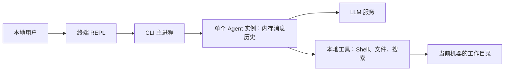
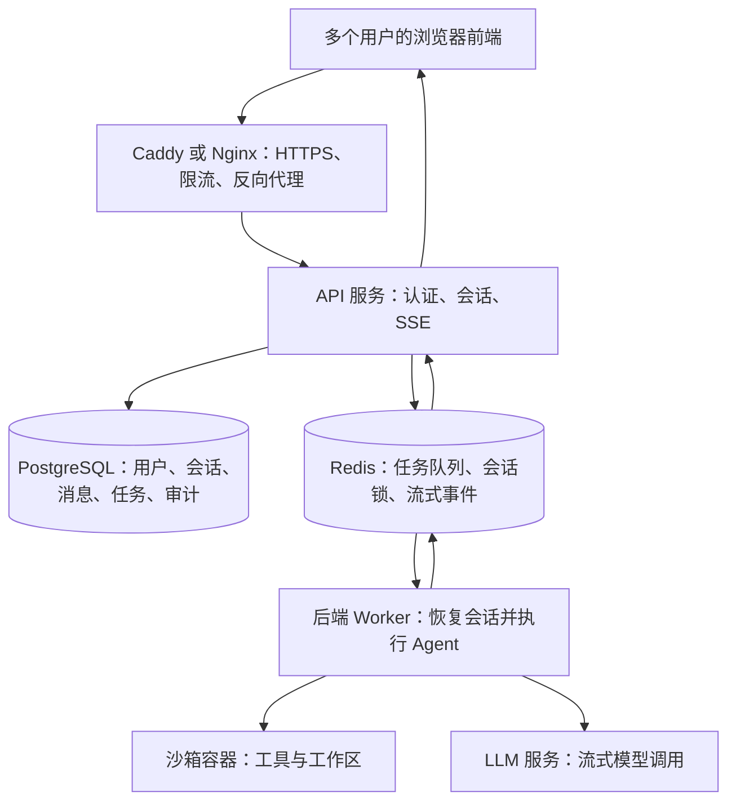
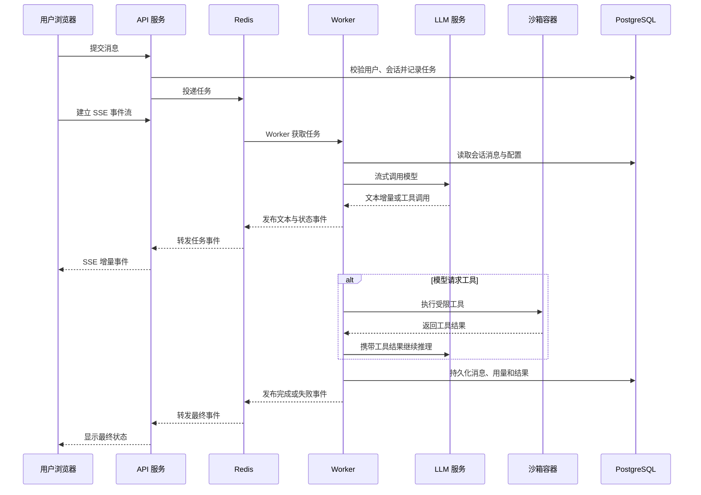

# 上线网页多人使用版

## 1. 方案定位

本方案将 CoreCoder 扩展为可通过互联网访问的网页 Agent 服务。用户在浏览器中提交消息，持续接收模型输出、工具执行状态和最终结果；不同用户、会话和工作区必须相互隔离。

该方案以现有 Agent 核心为基础，不将终端进程直接暴露到公网。网页服务负责身份验证、任务调度、状态持久化和流式传输；代码与命令工具在隔离运行环境中执行。

### 目标

- 已认证用户可通过网页创建和继续对话。
- 回复、工具状态和错误信息以流式方式展示。
- 同一会话保持连续上下文，不同用户和会话互不干扰。
- 多个用户可并发使用，系统可通过增加服务实例扩容。
- 命令执行、文件读写和联网能力受隔离与权限策略控制。

### 范围边界

- 公网可访问指登录入口可公开访问，不代表匿名用户可无限制调用 Agent。
- Web 版新增服务入口和运行环境，不改变 Agent 的模型调用与工具调用基本循环。
- 不将宿主机文件系统、宿主机 Shell 或模型 API Key 暴露给浏览器和任务容器。

## 2. 现有功能与扩展后设计对比

| 维度           | 现有 CLI 形态                               | 上线网页多人使用版                           |
| -------------- | ------------------------------------------- | -------------------------------------------- |
| 交互入口       | 本地终端 REPL                               | 浏览器对话页面和 HTTPS API                   |
| 请求执行       | 终端进程直接同步调用 `Agent.chat()`         | API 创建任务，Worker 异步执行 Agent          |
| 用户身份       | 本地单一使用者，无身份体系                  | 登录认证、用户权限和用量限制                 |
| 会话状态       | `Agent.messages` 保存在进程内存             | 消息、任务和会话元数据持久化到数据库         |
| 流式输出       | 通过本地回调输出到终端                      | 通过 SSE 事件推送到浏览器                    |
| 多用户并发     | 不支持多个用户共用一个 Agent 实例           | 每个任务创建独立 Agent；Worker 池并发处理    |
| 工具并发       | 单次 Agent 请求内可并发执行声明为安全的工具 | 保留该能力，同时隔离不同任务的运行环境       |
| 文件与命令     | 运行在当前本地环境                          | 运行在按用户/任务隔离的沙箱容器              |
| 上下文一致性   | 同一终端按输入顺序维护                      | 同一会话使用互斥锁串行执行，跨会话可并行     |
| 成本与滥用控制 | 本地配置限制                                | 用户配额、并发限制、限流、任务超时和预算限制 |
| 运行与扩容     | 单个 CLI 进程                               | 无状态 API 实例与 Worker 实例分别水平扩展    |

## 3. 总体架构

### 3.1 现有本地单机单人调用架构



### 3.2 扩展后多人调用架构


本地单人模式：终端 → CLI → Agent.chat()
网页多人模式：浏览器 → API → Worker → Agent.chat()

网页多人模式下，Worker 不会调用 CLI，而是直接创建或恢复本次任务的 Agent 实例，再调用 Agent.chat()

### 3.3 部署结构

代码仓库、构建产物和运行服务是三个不同层次。API 与 Worker 可以使用同一份 CoreCoder 代码和同一个应用镜像，但以不同进程和容器运行，不共享内存。

```text
CoreCoder 代码仓库
├─ Agent、LLM、工具等共享核心
├─ Web API 入口
└─ Worker 入口

部署后的运行服务
├─ gateway：HTTPS、反向代理和基础限流
├─ frontend：浏览器静态资源
├─ api：API 服务实例，可部署多个副本
├─ worker：任务执行进程，可部署多个副本
├─ postgres：用户、会话、消息、任务和审计数据
├─ redis：任务队列、会话锁和实时事件
└─ sandbox：由 Worker 调度的受限任务执行环境
```

首期可以将上述服务部署在一台 Linux 云服务器的 Docker Compose 环境中。`api` 与 `worker` 使用同一个应用镜像，但分别以 API 入口和 Worker 入口启动；PostgreSQL、Redis 和网关作为独立服务运行。后续扩容时，按负载分别增加 API 或 Worker 副本，而不需要复制或拆分 Agent 核心代码。

### 组件职责

- 浏览器前端：提交消息，展示增量文本、工具状态、确认请求、文件改动和任务结果。
- 网关：提供 TLS 终止、基础限流、请求大小限制和反向代理。
- API 服务：验证身份和权限，创建任务，读取会话，向浏览器提供 SSE 流。
- PostgreSQL：保存可恢复的业务状态，作为用户、会话和任务的事实来源。
- Redis：暂存待执行任务、管理同一会话锁、传递实时事件。
- Worker：后端的独立进程或服务，消费任务，构建独立 Agent，调用模型并协调工具执行；
- 沙箱容器：受限地运行 Bash、读写文件和其他具有副作用的工具。
### API 服务、Worker 与 Agent 的关系

API 服务是面向浏览器的后端进程。它处理登录、权限校验、创建任务、读取历史会话和维持 SSE 连接；它不应直接执行耗时的模型推理或工具调用。一个 API 实例可以同时处理多个用户的 HTTP 请求和 SSE 连接。

Worker 是面向任务执行的后端进程。它从队列取得任务，读取该会话的持久化上下文，创建本次任务专属的 Agent 实例，并调用 `Agent.chat()`。模型输出与工具状态由 Worker 发布为事件，再由 API 服务转发给浏览器。Worker 不是前端代码，也不是 Agent 本身；它是承载 Agent 任务的运行进程。

### Agent入口变化(CLI➡️Wroker)
Agent 的核心执行循环没有改变，变化的是调用入口：

| 使用场景         | 调用入口                     | 谁调用 `Agent.chat()` |
| ---------------- | ---------------------------- | --------------------- |
| 现有本地 CLI     | 终端 REPL                    | CLI 主进程            |
| 扩展后的网页请求 | API 创建任务后由 Worker 消费 | Worker 进程           |

因此，网页模式下 Agent 的直接执行入口从 CLI 调用链转为 Worker 调用链；这是一条新增的 Web 运行路径，而不是对原有 CLI 的替换。是否在后续实现中保留 CLI 作为发布功能，需在实施范围确认时决定。
CLI 负责终端输入、命令解析、终端渲染等交互；Worker 负责队列任务、会话恢复、事件发布和沙箱协调。两者复用的是 Agent、LLM、工具等核心能力。
### Redis 的作用、缺失影响与替代方式

Redis 承担的是跨 API 实例和 Worker 实例共享的短期协调能力，不存放长期事实数据。它在本方案中提供三类作用：

- 任务队列：API 将创建好的任务交给 Worker，避免 API 进程被长时间模型调用和工具执行占用。
- 会话锁：同一会话只允许一个 Worker 修改消息历史，避免两条并发消息交错写入上下文。
- 实时事件通道：Worker 发布文本和工具状态，任意 API 实例都可以取得事件并转发给对应 SSE 连接。

Redis 不是多人服务在技术上的唯一选择，但**任务调度、分布式锁和实时事件传递**这三项能力不可缺少。

虽然可用 PostgreSQL 的任务表、行锁和轮询替代，也可使用云消息队列等托管服务；这些替代方案会增加轮询延迟、实现复杂度或基础设施成本。

如果完全不使用 Redis 或其他等价组件：API 要么直接执行长任务，要么自行轮询数据库；多个 Worker 难以可靠协调同一会话；多个 API 实例也难以把某个 Worker 的事件转发到任意浏览器连接。此时通常需要固定用户连接到同一进程，或频繁查询数据库，扩容、断线重连和故障恢复都会变复杂。

## 4. 用户交互与任务生命周期

### SSE 连接与事件发生节点

SSE 是浏览器与 API 服务之间持续保持的单向事件连接，而不是只在模型输出文本时才存在的连接。浏览器在创建任务后建立该连接；连接会保持到任务完成、失败、取消或浏览器主动断开。

可以自定义`text_delta` 作为 SSE 中的一种文本增量事件。它应只在 LLM 正在返回可展示的文本片段时发送。模型请求工具、等待用户确认、执行工具、写入数据库或准备下一次模型调用时，文本增量会暂停；任务和 SSE 连接仍在继续。此时服务可发送具或任务状态事件，连接空闲时可发送心跳事件。

| 执行阶段                   | SSE 连接状态           | 可能发送的自定义事件                 |
| -------------------------- | ---------------------- | ------------------------------------ |
| 任务已创建、等待调度       | 已建立                 | `queued`、`running`                  |
| LLM 流式输出文本           | 保持连接               | `text_delta`                         |
| LLM 请求工具               | 保持连接，文本可能暂停 | `tool_started`                       |
| 等待用户确认               | 保持连接               | `awaiting_approval`                  |
| 执行工具并取得结果         | 保持连接               | `tool_finished` 或失败事件           |
| 再次调用 LLM               | 保持连接               | 后续 `text_delta` 或新的工具状态事件 |
| 最终消息与任务状态已持久化 | 保持连接               | `completed`                          |
| 完成、失败或取消后         | 正常结束               | 发送最终事件后关闭                   |

Worker 只在出现用户可见的文本或状态变化时发布事件；不会在整个任务期间持续发送 `text_delta`。事件发布路径为 Worker 发布到 Redis、API 读取并转发到 SSE、浏览器渲染。消息持久化不需要逐 Token 执行：创建任务、工具执行完成和任务完成是主要持久化节点；`completed` 必须在最终消息和任务状态成功持久化后发送。



### 建议的对外接口如下：

| 接口                                       | 用途                                                        |
| ------------------------------------------ | ----------------------------------------------------------- |
| `POST /api/tasks`                          | 提交用户消息并创建任务，返回任务标识。                      |
| `GET /api/tasks/{task_id}/events`          | 建立 SSE 连接，接收文本增量、工具状态、确认请求和结束事件。 |
| `POST /api/tasks/{task_id}/cancel`         | 请求取消仍在执行的任务。                                    |
| `POST /api/tasks/{task_id}/approvals`      | 同意或拒绝需要用户确认的高风险工具操作。                    |
| `GET /api/conversations`                   | 获取当前用户可访问的会话列表。                              |
| `GET /api/conversations/{conversation_id}` | 获取会话消息和任务历史。                                    |

## 5. 需求与解决方案

### 5.1 身份验证、访问控制与用量限制

网页入口可公开访问，但 Agent 调用必须绑定已认证用户。认证可采用 OAuth/OIDC 或邮箱登录，服务端使用安全 Cookie 或短期访问令牌维护登录状态。

每个请求均依据用户标识校验其对会话、工作区和任务的访问权。首期仅需区分普通用户与管理员；不需要提前引入复杂的组织、角色和团队模型。

为防止滥用和不可控的模型费用，服务端应按用户实施以下限制：

- 单位时间内的请求次数与输入大小限制。
- 同时运行的任务数量限制。
- 单任务最大执行时长和最大工具调用轮数。
- 每日或每月 Token、费用和工作区资源配额。
- 在登录与任务创建入口设置基础防刷措施。

模型 API Key 仅由服务端或密钥管理服务保存，前端永远不接触该密钥。

### 5.2 任务模型与 Worker 调度

任务是一次用户交互的业务记录，不等同于操作系统进程。创建任务后，API 服务立即返回任务标识；Worker 从队列中取得该任务后才实际调用 `Agent.chat()`。

API 服务不直接承担长时间的模型推理和工具执行。它应保持无状态，专注处理 HTTP 请求和 SSE 连接。Worker 是独立的后台执行进程，每个 Worker 在同一时刻只处理一个 Agent 任务；通过增加 Worker 数量提高用户任务并发量。

任务至少包含以下状态：

- `queued`：已创建，等待 Worker 获取。
- `running`：模型推理或工具执行中。
- `awaiting_approval`：等待用户确认高风险操作。
- `completed`：已产生最终回答。
- `failed`：模型、工具或基础设施发生不可恢复错误。
- `cancelled`：用户或系统终止任务。

任务取消应同时停止后续模型调用、终止沙箱中的执行，并写入可审计的结束原因。

### 5.3 会话上下文与并发一致性

现有 `Agent` 将消息历史保存在实例属性 `messages` 中，因此一个 Agent 实例只能服务一个串行会话。网页服务不能复用同一实例处理多个用户。

每次 Worker 处理任务时，应执行以下过程：

1. 以任务中的用户和会话标识校验访问范围。
2. 获取该会话的互斥锁，防止两条消息同时修改同一份历史。
3. 从数据库读取会话的完整模型消息历史，包括工具调用和工具结果。
4. 创建新的 Agent 实例并恢复消息历史；系统提示词和工具定义由该实例重新生成。
5. 运行任务并在完成后原子写入新增消息、压缩后的上下文、模型选择和用量信息。
6. 释放会话锁，使下一条消息基于最新上下文执行。

不同会话可以由不同 Worker 并行处理。多个前端的同一会话在已有一个任务运行期间应保持拒绝、排队或取消后续提交，具体策略在产品层固定为其中一种。

上下文压缩是会话状态的一部分。若 Agent 在运行中压缩历史，压缩后的消息记录必须回写数据库；否则下一次恢复会话时将丢失压缩结果或重新携带过长上下文。

### 5.4 浏览器流式交互

模型输出主要从服务端单向流向浏览器，使用 SSE 比 WebSocket 更适合首期实现。浏览器先创建任务，再建立该任务的事件流连接。

事件应至少包含以下类型：

| 事件                | 前端行为                       |
| ------------------- | ------------------------------ |
| `text_delta`        | 追加模型输出文本。             |
| `tool_started`      | 显示工具名称、目标和执行状态。 |
| `tool_finished`     | 展示工具完成、失败或摘要结果。 |
| `awaiting_approval` | 展示风险说明与允许/拒绝按钮。  |
| `completed`         | 固化最终回复并结束加载状态。   |
| `failed`            | 显示可理解的失败信息。         |
| `cancelled`         | 显示任务已停止。               |

Worker 将现有的文本与工具回调转换为上述事件，发送到 Redis；任一 API 实例都可从 Redis 获取事件并写入对应浏览器的 SSE 连接。事件需带有递增序号，以便浏览器断线重连后从最后一个已接收事件继续读取。

### 5.5 工具执行与沙箱隔离

当前 Agent 的 Bash、文件读写、搜索等工具面向本地可信环境。公网场景下，模型输出和用户输入都可能诱导执行危险命令，因此工具不得直接操作 API 服务器或 Worker 宿主机。

每个任务在独立沙箱容器中运行，容器只挂载当前用户被授权的工作区。沙箱应满足：

- 使用非 root 用户运行，基础文件系统尽可能只读。
- 不挂载宿主机目录、Docker Socket、云服务凭据或其他用户工作区。
- 设置 CPU、内存、磁盘、进程数、执行时长和输出大小上限。
- 默认禁止出站网络；仅在需要时开放模型服务、代码仓库等明确白名单。
- 工具参数经过服务端策略校验，写文件、执行命令和联网操作可要求用户确认。

若工作区需要跨任务保留，应以用户和项目维度单独保存，并在同一项目同时运行时增加工作区锁，避免并发写入覆盖文件。

### 5.6 数据持久化与审计

PostgreSQL 保存需要长期恢复和核查的状态：

- 用户、登录身份和基础配额。
- 会话及其消息序列。
- 任务状态、开始结束时间、模型和 Token 用量。
- 工具调用摘要、确认决策、失败原因和文件改动记录。
- 工作区元数据及其所属用户。

消息记录必须保留模型协议所需的角色、工具调用标识和工具结果，才能在后续任务中正确恢复 LLM 上下文。审计日志应避免记录 API Key、访问令牌和其他机密内容。

Redis 只承担短期队列、锁和实时事件传递，不作为唯一持久化来源。服务重启后，任务与会话的真实状态以数据库记录为准。

### 5.7 部署、扩容与可观测性

首期可在 Linux 云服务器上使用 Docker Compose 部署以下服务：

| 服务       | 职责                                 |
| ---------- | ------------------------------------ |
| `gateway`  | HTTPS 证书、反向代理、基础流量防护。 |
| `api`      | REST API、认证、会话查询和 SSE。     |
| `worker`   | 消费任务并驱动 Agent。               |
| `postgres` | 持久化业务数据。                     |
| `redis`    | 任务队列、锁和事件通道。             |
| `sandbox`  | 受限执行用户任务的容器运行环境。     |

反向代理只将浏览器流量分发给 API 实例，不直接将用户绑定到某个 Worker。任意 API 实例均可处理用户请求和 SSE 连接；任意空闲 Worker 均可执行任务，因为会话与任务状态已外置到 PostgreSQL 和 Redis。

扩容时应分别增加 API 与 Worker 实例：API 实例受 HTTP/SSE 连接数影响，Worker 实例受模型等待时间、工具执行资源和沙箱容量影响。先通过监控队列等待时间、任务耗时、失败率、Token 成本、沙箱资源和 SSE 连接数确定瓶颈，再扩展对应组件。

生产环境应配置结构化日志、任务链路标识、错误告警、数据库备份、密钥轮换和依赖安全更新。

## 6. 分阶段交付

1. 网页对话基础版：认证、会话持久化、任务 API、SSE 输出、用量限制；默认关闭具有副作用的本地工具。
2. 安全工具版：接入沙箱容器、工作区、工具策略和人工确认流程。
3. 多实例运行版：增加 API 与 Worker 副本、断线续传、监控告警、备份恢复与容量治理。

该顺序先建立安全的公网对话闭环，再逐步开放高风险的代码执行能力，避免将本地开发工具直接迁移为公网执行入口。
