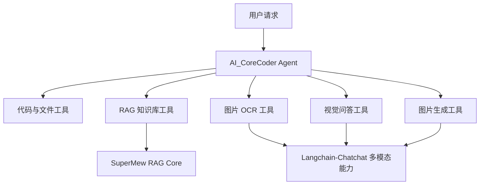

# AI_CoreCoder、SuperMew 与 Langchain-Chatchat 整合思路
- **SuperMew**: https://github.com/icey1287/SuperMew
- **Langchain-Chatchat**:https://github.com/chatchat-space/Langchain-Chatchat
## 1. 整合目标

以 `AI_CoreCoder` 为唯一的 Agent 核心，从 `SuperMew` 提取 RAG 能力，从 `Langchain-Chatchat` 提取图片处理与生成能力。

三个项目不进行整体合并，只组合职责明确的能力模块。

## 2. 项目职责

| 项目               | 整合后的职责                                           |
| ------------------ | ------------------------------------------------------ |
| AI_CoreCoder       | Agent 主循环、工具选择、上下文管理、代码操作和最终回答 |
| SuperMew           | 文档处理、向量存储、混合检索和 Agentic RAG             |
| Langchain-Chatchat | 图片 OCR、视觉问答和图片生成                           |

## 3. 总体架构

AI_CoreCoder 是唯一的顶层 Agent。SuperMew 和 Langchain-Chatchat 只提供工具能力，不参与顶层工具选择和 Agent 循环。

## 4. 保留 AI_CoreCoder 的内容

- Agent 主循环与模型调用。
- Tool 抽象、注册和调度。
- 代码、文件与 Shell 工具。
- 上下文、会话和子 Agent 管理。

AI_CoreCoder 负责判断何时调用 RAG、OCR、视觉问答或图片生成工具。

## 5. 从 SuperMew 提取的内容

- 文档解析、清洗、分块和元数据处理。
- Embedding 与向量存储。
- 语义检索、关键词检索、混合检索和结果重排。
- 查询重写、问题拆分、检索纠正和引用追踪等 Agentic RAG 能力。

SuperMew 只作为 RAG 能力来源，不引入其 Agent、前端和完整业务系统。

## 6. 从 Langchain-Chatchat 提取的内容

- 图片 OCR，并将识别文本交给 RAG 使用。
- 基于多模态模型的图片理解和视觉问答。
- 基于图片生成接口的文本生成图片能力。

Langchain-Chatchat 只作为图片能力的实现参考，不引入其 WebUI、Agent 和完整模型平台。

## 7. 整合边界

- `AI_CoreCoder` 是唯一的顶层 Agent 和工具调度入口。
- `SuperMew` 只提供 RAG 核心能力。
- `Langchain-Chatchat` 只提供图片相关能力参考。
- RAG、OCR、视觉问答和图片生成均作为独立工具接入。
- 不合并三个项目的前端、业务后端和 Agent 循环。
