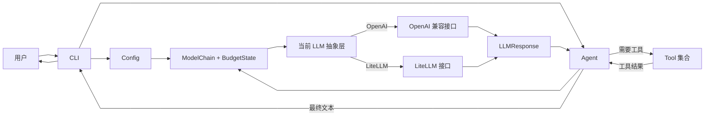
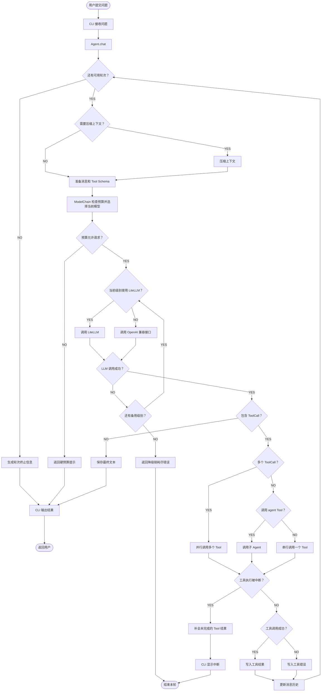
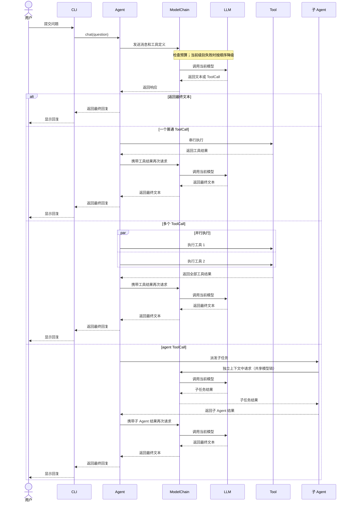

# CoreCoder 自定义数据结构

本文整理项目定义的 `class`、`@dataclass`，以及在多个模块之间传递或长期保存的关键 `dict`、`list`、`set`。不包含 Python 标准库和第三方库本身的类型，例如 `Path`、`OpenAI`、`Console`。

## 总览

```text
Config -- ModelChain.from_config() -> ModelChain -> Agent
                                      |-> 当前 LLM / LiteLLM
                                      |-> BudgetState
                                                   |-> messages: list[dict]
                                                   |-> ContextManager
                                                   |-> Tool 列表

Agent.chat() -> ModelChain.chat() -> 当前 LLM.chat() -> LLMResponse
                                                    -> ToolCall[] -> Tool.execute()
                                                                  -> 工具结果写回 messages
```

| 分类             | 结构                                                                                                     |
| ---------------- | -------------------------------------------------------------------------------------------------------- |
| 配置与模型通信   | `Config`、`ModelConfig`、`BudgetState`、`ModelChain`、`ToolCall`、`LLMResponse`、`LLM`、`LiteLLM`         |
| Agent 运行状态   | `Agent`、`ContextManager`、消息字典、会话 JSON                                                           |
| 工具体系         | `Tool`、`BashTool`、`ReadFileTool`、`WriteFileTool`、`EditFileTool`、`GlobTool`、`GrepTool`、`AgentTool` |
| 共享注册表与状态 | `ALL_TOOLS`、`_tool_by_name`、`_changed_files`、`_local`、`_PRICING` 等                                  |

## 一、配置与模型通信

### 1. `Config`

定义位置：[config.py](../../corecoder/config.py)。这是一个不可变的 `@dataclass`，集中保存已经解析完成的启动配置。

| 字段                 | 类型                        | 作用                                 |
| -------------------- | --------------------------- | ------------------------------------ |
| `primary`            | `ModelConfig`               | 已解析的主模型配置                   |
| `fallbacks`          | `tuple[ModelConfig, ...]`   | 按顺序解析的备用模型配置             |
| `max_context_tokens` | `int`                       | Agent 上下文上限                     |
| `max_cost_usd`       | `float \| None`             | 单个进程的硬预算上限（美元）         |

`Config.from_env()` 是环境变量配置的唯一入口。它只加载当前目录 `.env`，且不覆盖进程环境变量；随后解析 `CORECODER_PRIMARY_<FIELD>`、连续编号的 `CORECODER_FALLBACK_<N>_<FIELD>`、`CORECODER_MAX_CONTEXT_TOKENS` 与 `CORECODER_MAX_COST_USD`。每个已启用模型级别必须包含 `MODEL` 和显式 `API_KEY`，并可设置 `BACKEND`、`PROVIDER`、`BASE_URL`、`TEMPERATURE`、`MAX_TOKENS`。

CLI 的 `--model`、`--base-url`、`--api-key` 仅作为主模型字段覆盖，在 `Config` 构造前参与解析。优先级为 CLI、进程环境变量、当前目录 `.env`、默认值。旧 `CORECODER_MODEL`、`OPENAI_API_KEY` 等变量会直接产生迁移错误。

### 2. `ToolCall`

定义位置：[llm.py](../CoreCoder/corecoder/llm.py)。这是模型请求调用工具时的一条结构化记录。

```python
@dataclass
class ToolCall:
    id: str
    name: str
    arguments: dict
```

- `id`：本次工具调用的唯一标识，工具返回结果时必须使用同一个 ID。
- `name`：工具名，例如 `read_file`、`bash`。
- `arguments`：工具参数字典，例如 `{"file_path": "main.py"}`。

它将不同模型供应商返回的工具调用，统一为项目内部格式。

### 3. `LLMResponse`

定义位置：[llm.py](../CoreCoder/corecoder/llm.py)。这是 `LLM.chat()` 的统一返回值。

| 字段                | 作用                                     |
| ------------------- | ---------------------------------------- |
| `content`           | 模型生成的普通文本                       |
| `tool_calls`        | `list[ToolCall]`，模型希望执行的工具调用 |
| `prompt_tokens`     | 本次请求输入 Token 数                    |
| `completion_tokens` | 本次请求输出 Token 数                    |

`tool_calls` 使用 `field(default_factory=list)`，保证每个响应对象都有独立的空列表。

它的 `message` 属性会将自身转为 OpenAI 格式的 assistant 消息字典，供 `Agent.messages` 保存。

### 4. `LLM` 与 `LiteLLM`

定义位置：[llm.py](../CoreCoder/corecoder/llm.py)。它们是“模型客户端对象”，不仅存数据，也封装请求、流式解析、重试与 Token 累计逻辑。

| 结构      | 继承关系       | 作用                                  |
| --------- | -------------- | ------------------------------------- |
| `LLM`     | 无             | 使用 OpenAI SDK 调用 OpenAI 兼容接口  |
| `LiteLLM` | `LiteLLM(LLM)` | 使用 LiteLLM 调用非 OpenAI 兼容供应商 |

两者对外都提供 `chat(messages, tools, on_token)`，并都返回 `LLMResponse`。因此 `Agent` 不需要区分具体供应商。

它们主要保存模型名、额外请求配置和累计输入、输出 Token；`LLM` 还保存 OpenAI 客户端，`LiteLLM` 保存 API Key 和 Base URL。`has_known_cost` 是公开属性，用于告知预算层当前模型是否具备定价数据。

### 5. `ModelChain` 与 `BudgetState`

`ModelChain` 定义在 [fallback.py](../../corecoder/fallback.py)，是交给 `Agent` 的模型外观。CLI 通过 `ModelChain.from_config(config)` 用同一工厂构造主模型和有序备用模型；`backend` 选择 `LLM` 或 `LiteLLM`，`provider` 不参与该选择。模型链维护当前生效级别与熔断状态，并把总 Token 用量和已知模型的估算成本汇总到链级别。模型自身的三次重试仍由 `LLM` 或 `LiteLLM` 负责；某一级耗尽重试后，链才进入下一备用级别。

`BudgetState` 定义在 [budget.py](../../corecoder/budget.py)，只保存单进程的可变硬预算上限。`ModelChain.from_config()` 默认根据 `Config.max_cost_usd` 创建它；成本超过上限时，链拒绝新的模型请求。未知价格的当前模型通过 `has_known_cost` 标识，预算检查对此放行。`/budget` 只能在当前进程中调高该上限。

## 二、Agent 运行状态与持久化数据

### 1. `Agent`

定义位置：[agent.py](../CoreCoder/corecoder/agent.py)。这是项目的核心协调对象，负责模型、工具和对话状态之间的调度。

| 属性            | 作用                                                    |
| --------------- | ------------------------------------------------------- |
| `llm`           | 一个 `LLM` 或 `LiteLLM` 对象                            |
| `tools`         | 可用的 `Tool` 对象列表，默认使用 `ALL_TOOLS`            |
| `_tool_by_name` | `dict[str, Tool]`，将工具名映射到工具对象，便于快速查找 |
| `messages`      | `list[dict]`，当前对话历史，不含系统提示词              |
| `context`       | `ContextManager`，负责压缩历史                          |
| `max_rounds`    | 单次用户提问最多允许的“模型 -> 工具”循环次数            |
| `_system`       | 根据当前工具列表生成的系统提示词                        |

`Agent.chat()` 的逻辑是：追加用户消息 -> 请求模型 -> 若有 `ToolCall` 则执行工具并追加工具结果 -> 再请求模型 -> 返回最终文本。

### 2. 消息列表[字典] `messages: list[dict]`
>消息列表记录的是同一个 Agent 实例的整段对话历史，包含多次用户提问以及多轮的“模型 -> 工具 -> 模型”循环。
项目没有为消息单独定义 `Message` 类，而是直接使用符合 OpenAI 协议的字典。这是项目最重要的无类数据结构。
**消息列表中的每个元素都是一条消息字典，role 是共同字段，其他字段按消息类型出现，每个字典内容大概有如下几种组合：**

| 消息类型     | 常见字段                                  | 作用                       |
| ------------ | ----------------------------------------- | -------------------------- |
| 用户消息     | `role: "user"`、`content`                 | 用户输入                   |
| 模型文本消息 | `role: "assistant"`、`content`            | 模型最终回复               |
| 模型工具请求 | `role: "assistant"`、`tool_calls`         | 模型要求调用一个或多个工具 |
| 工具结果消息 | `role: "tool"`、`tool_call_id`、`content` | 对应某个工具调用的执行结果 |

工具结果的 `tool_call_id` 必须对应前面的 `ToolCall.id`。缺失结果会使消息历史不符合 API 协议，导致下一次请求失败。

### 3. `ContextManager`

定义位置：[context.py](../CoreCoder/corecoder/context.py)。它管理 `messages` 的大小，避免上下文超过模型限制。

| 属性            | 作用                           |
| --------------- | ------------------------------ |
| `max_tokens`    | 上下文 Token 上限              |
| `_snip_at`      | 50% 阈值，截短过长的工具输出   |
| `_summarize_at` | 70% 阈值，调用模型总结旧消息   |
| `_collapse_at`  | 90% 阈值，仅保留摘要和最近消息 |

`maybe_compress(messages, llm)` 会直接修改传入的消息列表。压缩时会避开“工具结果与发起该调用的 assistant 消息”之间的边界，防止产生孤立的工具结果。

### 4. 会话 JSON

定义位置：[session.py](../CoreCoder/corecoder/session.py)。会话没有对应类，而是保存为 JSON 字典：

```json
{
  "id": "session_...",
  "model": "gpt-5.5",
  "saved_at": "2026-07-21 18:00:00",
  "messages": []
}
```

`save_session()` 将 `messages` 和模型名写入 `~/.corecoder/sessions`；`load_session()` 返回 `(messages, model)` 元组。会话 ID 会先规范化，再确认目标路径仍位于会话目录内。

## 三、工具体系

### 1. `Tool` 抽象基类

定义位置：[tools/base.py](../CoreCoder/corecoder/tools/base.py)。`Tool` 是所有工具的统一接口，不直接完成具体工作。

每个子类必须提供：

| 成员                | 作用                         |
| ------------------- | ---------------------------- |
| `name`              | 给模型使用的工具名           |
| `description`       | 告诉模型工具能做什么         |
| `parameters`        | JSON Schema 格式的参数定义   |
| `execute(**kwargs)` | 实际执行功能并返回字符串结果 |

`schema()` 会把前三项包装为 OpenAI function calling 所需的字典。`Tool` 继承 Python 标准库的 `ABC`，`@abstractmethod` 保证子类必须实现 `execute()`。

`Tool` 还带一个类属性 `concurrency_safe: bool = False`，子类不声明即继承
`False`（默认拒绝）。它标记该工具的 `execute()` 是否可以和其他并发安全工具
同时运行而不产生副作用冲突；`Agent` 批量执行工具调用时依据这个属性决定调度
方式，见下文"具体工具类"表格和第八节。

### 2. 具体工具类

以下 7 个类都继承 `Tool`，因此 `Agent` 可以以同一种方式调用它们。

| 类              | 工具名       | 作用                                                       | `concurrency_safe` |
| --------------- | ------------ | ---------------------------------------------------------- | ------------------- |
| `BashTool`      | `bash`       | 执行 Shell 命令，检测部分危险命令、限制超时并截断过长输出  | `False`（默认）    |
| `ReadFileTool`  | `read_file`  | 按行读取文本文件，支持起始行和最大行数                     | `True`              |
| `WriteFileTool` | `write_file` | 创建文件或完整覆盖文件内容                                 | `False`（默认）    |
| `EditFileTool`  | `edit_file`  | 用唯一的 `old_string` 精确替换为 `new_string`，并返回 diff | `False`（默认）    |
| `GlobTool`      | `glob`       | 按 glob 模式查找文件，最多返回 100 个结果                  | `True`              |
| `GrepTool`      | `grep`       | 用正则搜索文件内容，跳过常见无关目录                       | `True`              |
| `AgentTool`     | `agent`      | 创建独立上下文的子 Agent，完成子任务后返回摘要             | `False`（默认）    |

`AgentTool` 比其他工具多一个 `_parent_agent` 引用。主 `Agent` 初始化时会注入自己；子 Agent 会复用父模型，但移除 `agent` 工具以禁止递归派生。`AgentTool` 保持 `concurrency_safe` 默认值——子 agent 内部可能触发写操作或消耗共享的降级/预算状态，不适合被当作并发安全工具处理。

## 四、共享注册表与辅助状态

这些结构不是类，但承载了多个对象共享的状态或规则。

| 结构                  | 类型               | 定义位置            | 作用                                                      |
| --------------------- | ------------------ | ------------------- | --------------------------------------------------------- |
| `ALL_TOOLS`           | `list[Tool]`       | `tools/__init__.py` | 默认工具实例注册表，`Agent` 未传入工具时使用它            |
| `_tool_by_name`       | `dict[str, Tool]`  | `Agent` 实例        | 由 `ALL_TOOLS` 或传入工具列表构建，按名称定位工具         |
| `_changed_files`      | `set[str]`         | `tools/edit.py`     | 本次进程内被写入或编辑过的文件路径，供 `/diff` 显示       |
| `_local`              | `threading.local`  | `tools/bash.py`     | 每个线程独立保存 Shell 当前目录，避免并行命令互相覆盖目录 |
| `_PRICING`            | `dict[str, tuple]` | `llm.py`            | 模型名到“每百万输入/输出 Token 单价”的映射，用于成本估算  |
| `_DANGEROUS_PATTERNS` | `list[tuple]`      | `tools/bash.py`     | 正则表达式与风险说明的列表，用于拒绝部分高危 Shell 命令   |
| `_SKIP_DIRS`          | `set[str]`         | `tools/grep.py`     | `grep` 递归搜索时忽略的目录名集合                         |
| `SESSIONS_DIR`        | `Path`             | `session.py`        | 会话 JSON 的固定存储目录                                  |

`Agent` 执行一批 `tool_calls` 时，还会调用 `_segment_tool_calls()` 按
`Tool.concurrency_safe` 把它们分成若干 `(is_safe, calls)` 段——这是一个只
在方法内部临时构造的 `list[tuple[bool, list]]`，不长期保存，因此没有单独
列进上表；具体算法见第五节 `_exec_tools_parallel()` 的源码。

### 关系总结

1. `Config` 决定主模型、备用级别和硬预算上限；CLI 通过 `ModelChain.from_config()` 创建主备客户端、`BudgetState` 与 `ModelChain`。
2. `Agent` 持有 `ModelChain`、`ContextManager`、工具列表和消息列表；子 Agent 复用同一条 `ModelChain`，因而共享熔断与预算状态。
3. `ModelChain` 在每个模型自身重试耗尽后按顺序路由到下一级，并在成功降级后保持该当前级别；`/model` 会重置熔断状态。
4. 当前 `LLM` 将供应商流式响应解析为 `LLMResponse`；其中的 `ToolCall` 指向某个 `Tool`。
5. `Agent` 通过 `_tool_by_name` 找到工具，执行后把工具结果字典写回 `messages`。
6. 多个 `tool_calls` 会先按 `Tool.concurrency_safe` 分段，再分别用线程池并发或直接串行执行，结果仍按原始调用顺序写回 `messages`。
7. `ContextManager` 在需要时压缩同一个 `messages` 列表；会话功能将该列表持久化为 JSON。

## 五、数据结构定义源码

本节列出结构定义所需的字段、继承关系、构造函数与工具参数 Schema。`execute()`、`chat()` 等方法的具体执行算法不属于数据结构定义，因此只保留方法签名；完整实现可通过每个小节的源码链接查看。

### 1. 数据类

来源：[config.py](../../corecoder/config.py) 与 [llm.py](../../corecoder/llm.py)。以下省略校验与摘要方法，只保留字段结构。

```python
from __future__ import annotations

from dataclasses import dataclass, field


@dataclass(frozen=True)
class ModelConfig:
    model: str
    api_key: str
    backend: str = "openai_compatible"
    provider: str = "openai"
    base_url: str | None = None
    temperature: float = 0.0
    max_tokens: int = 4096


@dataclass(frozen=True)
class Config:
    primary: ModelConfig
    fallbacks: tuple[ModelConfig, ...] = ()
    max_context_tokens: int = 128_000
    max_cost_usd: float | None = None


@dataclass
class ToolCall:
    id: str
    name: str
    arguments: dict


@dataclass
class LLMResponse:
    content: str = ""
    tool_calls: list[ToolCall] = field(default_factory=list)
    prompt_tokens: int = 0
    completion_tokens: int = 0
```

### 2. 运行协调对象的构造函数

来源：[llm.py](../../corecoder/llm.py)、[fallback.py](../../corecoder/fallback.py)、[budget.py](../../corecoder/budget.py)、[agent.py](../../corecoder/agent.py)、[context.py](../../corecoder/context.py)。

```python
from typing import Any, Callable, Sequence


class LLM:
    def __init__(
        self,
        model: str,
        api_key: str,
        base_url: str | None = None,
        **kwargs,
    ):
        self.model = model
        self.client = OpenAI(api_key=api_key, base_url=base_url)
        self.extra = kwargs
        self.total_prompt_tokens = 0
        self.total_completion_tokens = 0

    def chat(self, messages: list[dict], tools: list[dict] | None = None, on_token=None) -> LLMResponse:
        ...


class LiteLLM(LLM):
    def __init__(
        self,
        model: str,
        api_key: str | None = None,
        base_url: str | None = None,
        **kwargs,
    ):
        self.model = model
        self.api_key = api_key
        self.base_url = base_url
        self.extra = kwargs
        self.total_prompt_tokens = 0
        self.total_completion_tokens = 0


class BudgetState:
    def __init__(self, limit_usd: float | None = None):
        self.limit_usd = limit_usd

    def set_limit(self, value: float, *, only_increase: bool = False) -> float:
        ...


class ModelChain:
    def __init__(
        self,
        primary: Any = None,
        fallbacks: Sequence[Any] | None = None,
        *,
        llm: Any = None,
        models: Sequence[Any] | None = None,
        budget: BudgetState | None = None,
        llm_factory: Callable[..., Any] | None = None,
    ):
        ...

    @classmethod
    def from_config(
        cls,
        config: Config,
        *,
        budget: BudgetState | None = None,
        llm_factory: Callable[[ModelConfig], Any] | None = None,
    ) -> "ModelChain":
        ...


class ContextManager:
    def __init__(self, max_tokens: int = 128_000):
        self.max_tokens = max_tokens
        self._snip_at = int(max_tokens * 0.50)
        self._summarize_at = int(max_tokens * 0.70)
        self._collapse_at = int(max_tokens * 0.90)


class Agent:
    def __init__(
        self,
        llm: LLM | ModelChain,
        tools: list[Tool] | None = None,
        max_context_tokens: int = 128_000,
        max_rounds: int = 50,
        model_chain: ModelChain | None = None,
    ):
        self.llm = model_chain if model_chain is not None else llm
        self.model_chain = self.llm if isinstance(self.llm, ModelChain) else model_chain
        self.tools = tools if tools is not None else ALL_TOOLS
        self._tool_by_name = {t.name: t for t in self.tools}
        self.messages: list[dict] = []
        self.context = ContextManager(max_tokens=max_context_tokens)
        self.max_rounds = max_rounds
        self._system = system_prompt(self.tools)
```

`Agent.__init__()` 后面还会遍历 `self.tools`，为每个 `AgentTool` 写入 `_parent_agent`。这部分是对象关联逻辑，不新增 `Agent` 自身字段。

### 3. `Tool` 基类定义

来源：[tools/base.py](../CoreCoder/corecoder/tools/base.py)。

```python
from abc import ABC, abstractmethod


class Tool(ABC):
    name: str
    description: str
    parameters: dict
    concurrency_safe: bool = False

    @abstractmethod
    def execute(self, **kwargs) -> str:
        ...

    def schema(self) -> dict:
        return {
            "type": "function",
            "function": {
                "name": self.name,
                "description": self.description,
                "parameters": self.parameters,
            },
        }
```

### 4. 具体工具类的定义

以下代码保留每个工具的类名、继承关系、工具名、参数 Schema 和 `execute()` 签名。方法体省略；它们分别位于 [`tools/`](../CoreCoder/corecoder/tools) 目录。

```python
class BashTool(Tool):
    name = "bash"
    parameters = {
        "type": "object",
        "properties": {
            "command": {"type": "string", "description": "The shell command to run"},
            "timeout": {"type": "integer", "description": "Timeout in seconds (default 120)"},
        },
        "required": ["command"],
    }

    def execute(self, command: str, timeout: int = 120) -> str:
        ...


class ReadFileTool(Tool):
    name = "read_file"
    parameters = {
        "type": "object",
        "properties": {
            "file_path": {"type": "string", "description": "Path to the file"},
            "offset": {"type": "integer", "description": "Start line (1-based). Default 1."},
            "limit": {"type": "integer", "description": "Max lines to read. Default 2000."},
        },
        "required": ["file_path"],
    }

    def execute(self, file_path: str, offset: int = 1, limit: int = 2000) -> str:
        ...


class WriteFileTool(Tool):
    name = "write_file"
    parameters = {
        "type": "object",
        "properties": {
            "file_path": {"type": "string", "description": "Path for the file"},
            "content": {"type": "string", "description": "Full file content to write"},
        },
        "required": ["file_path", "content"],
    }

    def execute(self, file_path: str, content: str) -> str:
        ...


class EditFileTool(Tool):
    name = "edit_file"
    parameters = {
        "type": "object",
        "properties": {
            "file_path": {"type": "string", "description": "Path to the file to edit"},
            "old_string": {"type": "string", "description": "Exact text to find (must be unique in file)"},
            "new_string": {"type": "string", "description": "Replacement text"},
        },
        "required": ["file_path", "old_string", "new_string"],
    }

    def execute(self, file_path: str, old_string: str, new_string: str) -> str:
        ...


class GlobTool(Tool):
    name = "glob"
    parameters = {
        "type": "object",
        "properties": {
            "pattern": {"type": "string", "description": "Glob pattern, e.g. '**/*.py' or 'src/**/*.ts'"},
            "path": {"type": "string", "description": "Directory to search in (default: cwd)"},
        },
        "required": ["pattern"],
    }

    def execute(self, pattern: str, path: str = ".") -> str:
        ...


class GrepTool(Tool):
    name = "grep"
    parameters = {
        "type": "object",
        "properties": {
            "pattern": {"type": "string", "description": "Regex pattern to search for"},
            "path": {"type": "string", "description": "File or directory to search (default: cwd)"},
            "include": {"type": "string", "description": "Only search files matching this glob (e.g. '*.py')"},
        },
        "required": ["pattern"],
    }

    def execute(self, pattern: str, path: str = ".", include: str | None = None) -> str:
        ...


class AgentTool(Tool):
    name = "agent"
    parameters = {
        "type": "object",
        "properties": {
            "task": {"type": "string", "description": "What the sub-agent should accomplish"},
        },
        "required": ["task"],
    }
    _parent_agent: "Agent | None" = None

    def execute(self, task: str) -> str:
        ...
```

所有具体工具还有 `description` 类属性。为避免与前面的功能表重复，未在此重复列出；`Tool.schema()` 会把 `name`、`description`、`parameters` 一起发送给模型。

### 5. 无类数据结构的源码定义

来源：[tools/__init__.py](../CoreCoder/corecoder/tools/__init__.py)、[tools/edit.py](../CoreCoder/corecoder/tools/edit.py)、[tools/bash.py](../CoreCoder/corecoder/tools/bash.py)、[tools/grep.py](../CoreCoder/corecoder/tools/grep.py)、[llm.py](../CoreCoder/corecoder/llm.py)。

```python
ALL_TOOLS = [
    BashTool(),
    ReadFileTool(),
    WriteFileTool(),
    EditFileTool(),
    GlobTool(),
    GrepTool(),
    AgentTool(),
]

_changed_files: set[str] = set()
_local = threading.local()

_SKIP_DIRS = {".git", "node_modules", "__pycache__", ".venv", "venv", ".tox", "dist", "build"}

_PRICING = {
    "gpt-5.5": (5, 30),
    # 其余模型价格映射见 llm.py
}
```

`_DANGEROUS_PATTERNS` 也是列表结构，元素形如 `(正则表达式, 风险说明)`；完整规则直接见 [bash.py](../CoreCoder/corecoder/tools/bash.py)。

# CoreCoder 命令行接口

命令行接口分为启动参数和交互内置命令两部分。两者均由 [cli.py](../CoreCoder/corecoder/cli.py) 实现，但处理时机和职责不同。

## 1. 启动参数

`_parse_args()` 使用 `argparse` 在 `main()` 开始时解析启动参数。参数只解析一次，用于创建或恢复运行环境；随后才进入单次运行模式或交互 REPL。

| 参数 | 作用 | 生效方式 |
| --- | --- | --- |
| `-m`, `--model` | 指定主模型名 | 在构造 `Config.primary` 前覆盖 `CORECODER_PRIMARY_MODEL`。 |
| `--base-url` | 指定主模型 API 地址 | 在构造 `Config.primary` 前覆盖 `CORECODER_PRIMARY_BASE_URL`。 |
| `--api-key` | 指定主模型 API Key | 在构造 `Config.primary` 前覆盖 `CORECODER_PRIMARY_API_KEY`。 |
| `-p`, `--prompt` | 提供单次提示词 | 调用一次 `Agent.chat()` 后退出，不进入交互 REPL。 |
| `-r`, `--resume ID` | 恢复已保存会话 | 加载 `messages` 和显式运行时模型覆盖；指定 `--model` 时优先使用该参数。 |
| `-v`, `--version` | 显示版本 | 由 `argparse` 输出版本并结束程序。 |

例如，`corecoder --model gpt-5.4 --resume session_123` 在启动时设置模型并恢复会话。

## 2. 交互内置命令

程序未使用 `--prompt` 时会进入 `_repl()`。用户在 `You >` 提示符中输入以下命令，由 REPL 在调用 `Agent.chat()` 前直接处理。

| 输入 | 作用 |
| --- | --- |
| `/help` | 显示交互命令和输入快捷键。 |
| `/reset` | 清空当前对话历史。 |
| `/model` | 显示当前模型。 |
| `/model <name>` | 在当前进程中切换模型。 |
| `/tokens` | 显示累计输入、输出 Token 及可用时的费用估算。 |
| `/budget` | 显示当前硬预算上限；未配置时显示无限制。 |
| `/budget <usd>` | 将硬预算上限调高为指定的非负美元金额。 |
| `/compact` | 对当前对话历史执行上下文压缩，并显示压缩前后的估算 Token 数。 |
| `/diff` | 显示当前会话修改过的文件。 |
| `/save` | 将当前会话保存到磁盘。 |
| `/sessions` | 列出已保存会话。 |
| `quit`、`exit`、`/quit`、`/exit` | 退出交互 REPL。 |

未被识别且以 `/` 开头的输入会显示未知命令提示，不会发送给模型。普通文本输入才会作为用户消息传入 `Agent.chat()`。

## 3. 两类命令的边界

启动参数用于确定初始配置、恢复会话和选择运行模式；交互内置命令用于操作已创建的 `Agent`、`ModelChain`、预算状态和会话状态。`/model <name>` 可以改变主模型并重置熔断状态，但不修改下一次启动时使用的环境变量或配置文件；`/budget <usd>` 只能调高当前进程的硬预算上限。

# CoreCoder 调用路径图

## 1. 整体架构图



| 节点            | 功能                                            |
| --------------- | ----------------------------------------------- |
| 用户            | 提交问题并接收最终回复。                        |
| CLI             | 读取 Config，创建模型链，接收输入并显示结果。   |
| Config          | 集中解析主模型、备用级别和硬预算。              |
| ModelChain + BudgetState | 在预算允许时选择当前模型，并维护降级与熔断状态。 |
| Agent           | 管理消息历史，经模型链发起请求，分派 Tool 并控制循环。 |
| 当前 LLM 抽象层 | 统一封装当前模型后端的调用方式。                |
| OpenAI 兼容接口 | 调用 OpenAI 或兼容 OpenAI 协议的模型服务。      |
| LiteLLM 接口    | 通过 LiteLLM 调用其他模型供应商。               |
| LLMResponse     | 保存 LLM 返回的文本、ToolCall 和 Token 信息。   |
| Tool 集合       | 执行文件、命令、搜索或子 Agent 等操作。         |

## 2. 调用流程图



## 3. 调用时序图



说明：上图使用 `alt / else` 将一次 LLM 返回后的时序划分为四个选择分区，每次只进入其中一个分区。

- 返回最终文本：没有 `ToolCall`，Agent 直接向用户返回回复。
- 一个普通 ToolCall：只有一个非 `agent` Tool，Agent 串行执行它。
- 多个 ToolCall：同时返回多个 Tool，Agent 并行执行；其中可以包含 `agent` Tool。
- agent ToolCall：只有一个 `agent` Tool，主 Agent 等待子 Agent 完成。

后三个分区完成后，结果都会交回主 Agent。LLM 可能继续选择新的 ToolCall 分区，也可能进入“返回最终文本”分区；若达到终止条件，则流程结束。
